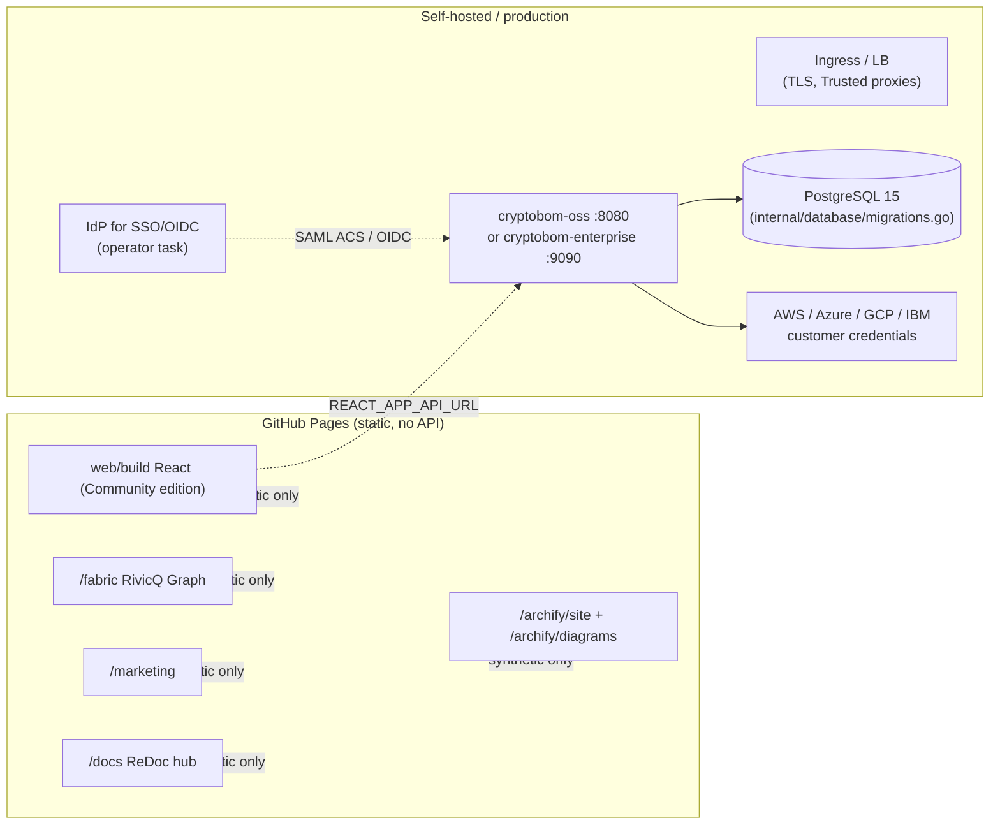

# Architecture: RivicQ CSPM / CryptoBOM EaaS

This document describes the concrete system architecture of the repository and its deployment topology. Companion reading: `docs/TRD.md` (requirements), `docs/CORE_ENGINE.md` (engine contract), `docs/editions.md` (edition split), `docs/DEPLOYMENT.md` (helm/compose), `docs/CLIENT_ARCHITECTURE.md` (discover/mitigate/report).

Honest boundaries: this product does not claim certifications, does not reverse-engineer firmware at runtime, and cloud/HSM/quantum connectors require customer-supplied credentials.

Processing pipeline (one engine): **Input → Discovery → Normalization (`intelligence.Finding`, including presence/detection/exploitability) → Evidence → Crypto intelligence / PQC taxonomy → Risk/policy gate → BOM (CycloneDX CBOM + unified view) → CLI / API / UI / GitHub Action.** Archify (`archify/`) is a static diagram site, not a second engine. RivicQ Graph (`fabric/`) is a labeled synthetic demo. There is no in-repo module named REA.

## 1. Component diagram

```mermaid
flowchart TB
    subgraph Operator["Operators"]
        CLI["cmd/rivicq CLI"]
        GA["GitHub Action\n.github/actions/rivicq-scan"]
        WH["GitHub webhook\nPOST /api/v1/github/webhook"]
    end

    subgraph Edge["Gin API server (internal/server/server.go)"]
        MW["middleware: RequestID, SecurityHeaders,\nAudit, RateLimit, CORS\n(internal/middleware)"]
        ED["edition.Detect()\ninternal/edition"]
        TN["tenant.Resolve()\nfrom JWT tenant_id\ninternal/tenant"]
        AUTH["internal/authn: JWT, bcrypt,\nTOTP, OAuth"]
    end

    subgraph Engine["Shared engine (both editions)"]
        DISC["internal/discovery\ntls.go ssh_scanner.go http_scanner.go\nsbom_scanner.go target_policy.go"]
        INT["internal/intelligence\nnormalize.go risk.go policy.go\npqc_class.go cyclonedx.go"]
        BOM["internal/bom + cryptoart\nCBOM framework, artifact model"]
        FW["internal/firmware / identity / certeng\nstatic metadata analysis"]
        QUANT["internal/quantum\nlocal Qiskit taxonomy, attestation"]
        COMP["internal/compliance\ncontrol mappings (not certification)"]
    end

    subgraph Ent["Enterprise control plane (internal/api/enterprise)"]
        APIK["apikeys.go webhooks.go tenancy.go\ninventory.go compliance.go multicloud.go\nquantum_attestation.go cspm.go"]
        CLOUD["internal/awscloud azurecloud gcpcloud ibmcloud\n(customer credentials required)"]
        AUDIT["audit_events / audit.go"]
    end

    subgraph Data["Storage"]
        PG[("PostgreSQL >= 15\ntables in internal/database/migrations.go\n+ deploy/migrations/*.sql")]
        MEM[("in-memory demo store\nwhen no DB configured")]
    end

    subgraph Ui["Frontends"]
        REACT["web/ React 18 + MUI 5\nroutes in web/src/App.tsx"]
        FABRIC["fabric/ RivicQ Graph (labeled demo)"]
        MARKETING["marketing/ static site"]
        ARCH["archify/ product diagram site"]
        DOCS["docs/ + ReDoc from openapi.yaml"]
    end

    CLI --> DISC
    GA --> CLI
    WH --> MW
    Operator -->|"HTTPS"| MW
    MW --> ED
    MW --> AUTH
    AUTH --> TN
    ED --> Ent
    MW --> DISC
    DISC --> INT
    INT --> BOM
    INT --> QUANT
    INT --> COMP
    FW --> DISC
    QUANT --> Ent
    BOM --> PG & MEM
    INT --> PG & MEM
    CLOUD --> PG
    AUDIT --> PG
    APIK --> PG
    Ent --> REACT
    REACT -->|"axios /api/v1"| MW
    Docs deploy --> Ui
```

## 2. Runtime and listens

| Surface | Port | Binary |
|---|---|---|
| OSS (Community) API | `:8080` | `cmd/server/oss/main.go` |
| Enterprise API | `:9090` | `cmd/server/enterprise/main.go` (gin release mode) |
| React dev server | `:3000` | `web/` (`npm run dev`) |
| GitHub Pages static | 443 (managed) | built output of `web/build` |

Edition activation: `internal/edition/edition.go` -> `Detect()` checks `CRYPTOBOM_LICENSE_KEY` for an `ENT-` prefix of >= 20 characters. OSS and Enterprise ship the **same engine**; the Enterprise binary adds control-plane routes (`cmd/server/server.go` `routeHooks`, `internal/api/enterprise/SetupRoutes`).

## 3. Request lifecycle

1. Gin engine runs middleware wired in `internal/middleware/middleware.go` (Setup): `RequestID` -> `SecurityHeaders` -> `Audit` -> `RateLimit` -> `CORS` -> edition header.
2. `TRUSTED_PROXIES` opt-in governs whether `X-Forwarded-For` is honored (default: trust none, so audit + rate limit cannot be bypassed by header spoofing).
3. Auth middleware (`internal/authn/middleware.go`, `internal/api/shared/standard_auth.go`) validates JWT/API key/optional auth and stores `tenant_id` on the gin context.
4. `internal/tenant.Resolve(c)` reads the context value; unauthenticated traffic maps to `PublicTenantID` (`00000000-0000-0000-0000-000000000001`).
5. Route handlers partition every scan/inventory/finding/GitHub/BOM query by tenant; cross-tenant or unknown scan IDs return `404` rather than leaking data.
6. Scan jobs return `202` and stream progress over SSE (`/api/v1/scans/:id/stream`).

## 4. Shared engine contracts (do not break)

- `discovery.ScanResult` is the core JSON report shape (`GET /scans/:id/report`). Do not change it for UI or auth work (`docs/CORE_ENGINE.md`).
- `internal/intelligence.Finding` is the single normalized finding model (source, scanner, rule, fingerprint, severity, risk breakdown, PQC class) consumed by API, CLI, and dashboard.
- Policy gate actions: `BLOCK` / `WARN` / `ALLOW` / `INFORM`; `--fail-on severity` supported (`internal/intelligence/failon.go`).
- CycloneDX 1.6 CBOM export from `/scans/:id/cyclonedx`.

## 5. Data plane

- Scanners: `internal/discovery` (TLS, SSH, HTTP headers/MD5, SBOM directory scan with the `cryptoLibraries` profile map, declared k8s/hardware targets), GitHub content scan (`internal/api/shared/github_scanning.go`), and optional external tools (Syft/Trivy/Grype/Gitleaks/OSV, `internal/intelligence/adapters_external.go`).
- SBOM to CBOM conversion (`internal/discovery/sbom_scanner.go`) maps package names to algorithmic profiles with BSI references and PQC status.
- Firmware/identity analysis (`internal/firmware`, `internal/identity`, `internal/certeng`, `internal/profile`) is static and evidence-based with size caps and RBAC (`scans:start`). See `docs/FIRMWARE_ANALYSIS.md` and `docs/IDENTITY_CRYPTO.md`.

## 6. Control plane (Enterprise only)

Backed by `internal/api/enterprise/`:

- API keys (`apikeys.go`), webhooks (`webhooks.go`), tenancy enforcement (`tenancy.go`), audit viewer (`audit.go`), compliance/conformance packs (`compliance.go`, `cncf.go`), inventory (`inventory.go`), multi-cloud connectors (`multicloud.go`, `cloud_sdk.go`), quantum attestation (`quantum_attestation.go`), Terraform IaC (`terraform.go`), threat engine (`threat_engine.go`), AI analysis (`ai_analysis.go`).
- RBAC roles Viewer < Analyst < Operator < Admin enforced server-side via `RequireRole` (`internal/auth/rbac.go`).
- Mutating SSO, cloud-connector, API-key, webhook, and workspace-role routes require Admin.

## 7. Deployment topology



- **GitHub Pages** (`docs/GITHUB_ACTIONS_AND_PAGES.md`): `.github/workflows/pages.yml` builds `web/` with `REACT_APP_EDITION=community`, ReDoc from `docs/openapi.yaml`, `fabric/`, `marketing/`, `docs/`, and `archify/`, then publishes to the `gh-pages` branch via `peaceiris/actions-gh-pages`.
- **Local demo**: `docker-compose.yml` (db + migrate + app + web + scanner) or `make dev-backend` / `make dev-enterprise` / `make dev-frontend`. In-memory demo mode when no DB is configured; `/readyz` returns 503 in demo mode and `/healthz` stays independent.
- **Helm**: OSS chart `deploy/helm/cryptobom-oss`, SaaS/Enterprise charts `deploy/helm/cryptobom-saas` and `deploy/helm/cryptobom-enterprise`; `deploy/kubernetes` yaml for enterprise deployments.
- **Cloudflare Pages**: `_headers`, `_redirects`, and `wrangler.toml` are being added at the repo root (not yet committed at the time of writing) as a static Publish-Only host; the same built `web/` output is hosted there with Pages-managed TLS.

## 8. Observability

- Structured logging via `logrus` (level `CRYPTOBOM_LOG_LEVEL`).
- Audit events to `audit_events` (tenant, actor, action vocabulary, request id) for the Enterprise viewer.
- OpenTelemetry tracing opt-in: `internal/observability/otel.go` exports OTLP/HTTP when `OTEL_EXPORTER_OTLP_ENDPOINT` is set; otherwise spans are in-process and dropped. Tracing middleware is wired per-service in the Enterprise main.
- `/healthz` (liveness, never fails on dependencies) and `/readyz` (readiness, 503 without DB or in demo mode), plus `PrometheusRule` templates in Helm charts.

## 9. Known boundaries

- GitHub Pages exposes **no** production API; demo access is a client marker, not a JWT.
- Disconnected cloud connectors show empty states, never fabricated customer estates (except the labeled demo).
- Compliance dashboards and PDF packs are control mappings, not certifications.
- Qiskit/algo scores are a local classical taxonomy; no IBM Quantum hardware is run by default.