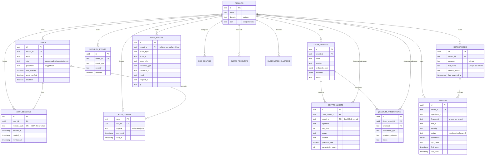

# Data Model: Scan / BOM / Finding / Tenant Domain

Source of truth: the Go migration ledger in `internal/database/migrations.go` (8 core migrations, checksum-guarded in `internal/database/migrate.go`) and the legacy SQL in `deploy/migrations/001_initial_schema.sql`, `002_enterprise_features.sql`, `003_add_auth_columns.sql`. Deployed via Postgres 15 (`docker-compose.yml`) or the in-memory demo store when no database is configured (`internal/server/server.go:86`).

## 1. Entity relationship overview

## 2. Core tables (migration `0001`, tuned by `0002`)

| Table | Purpose | Key columns |
|---|---|---|
| `tenants` | Workspace root; `plan` distinguishes community/enterprise (`id TEXT PRIMARY KEY`) | `id`, `name`, `domain` (unique), `plan` |
| `users` | Accounts bound to a tenant; password is a bcrypt hash (`internal/authn/password.go`) | `email` (unique), `role`, `password`, `mfa_secret`, `organisation` |
| `cbom_reports` | One CBOM/SBOM report per scan; canonical CycloneDX JSONB body | `tenant_id`, `cyclonedx_bom`, `status` |
| `crypto_assets` | Algorithm-level entries derived from a report; carries quantum-readiness | `cbom_report_id`, `algorithm`, `key_size`, `usage`, `quantum_safe`, `vulnerability_score` |
| `findings` | Fingerprinted, deduplicated findings with a lifecycle (`first_seen`/`last_seen`/`status`), migration `0004` | `fingerprint`, `rule_id`, `severity`, `pqc_class`, `risk_score`, `confidence` |
| `security_events` | Alert/event stream per tenant | `event_type`, `severity`, `resolved` |
| `audit_events` | Immutable request/action audit trail; tenant nullable with `ON DELETE SET NULL`, indexed `(tenant_id, created_at DESC)` | `event_type`, `actor_id`, `actor_role`, `resource_type`, `result`, `request_id`, `ip`, `latency_ms` |
| `repositories` | Connected GitHub repos owning scans (migration `0006`) | `provider`, `full_name` unique per tenant, `last_scanned_at` |
| `sso_configs` | Stored SAML/OIDC/LDAP provider config; the IdP ACS handshake is an operator task | `provider`, `enabled`, metadata JSONB |
| `cloud_accounts` | Customer cloud connections (AWS/Azure/GCP/IBM) | `provider`, `account_id`, `status` |
| `kubernetes_clusters` | Declared cluster inventory | `name`, `endpoint`, `version`, `status` |
| `auth_sessions` | Refresh sessions; only SHA-256 of the raw token stored, `RotatedTo`/`RevokedAt` for reuse detection (migration `0008`) | `refresh_hash`, `expires_at`, `rotated_to`, `revoked_at` |
| `auth_tokens` | Single-use out-of-band tokens (verify, reset, MFA challenge), addressed by hash | `hash`, `purpose`, `used_at` |
| `commercial_leads` | CRM lead intake from the public site | `email`, `company`, `intent`, `stage` |
| `hsm_keys`, `quantum_scans`, `cloud_connections`, `enterprise_audit_events` | Enterprise feature tables in `deploy/migrations/002_enterprise_features.sql` | provider-scoped |

## 3. Tenant model

- Tenant key is a `TEXT` id; JWT claims carry `tenant_id`, resolved at runtime by `internal/tenant/context.go`. The `X-Tenant-ID` header is never a source of truth.
- Unauthenticated Community traffic shares `PublicTenantID` (`00000000-0000-0000-0000-000000000001`) for the Home CBOM pilot.
- Ownership is denormalised onto children: migration `0003` backfills `crypto_assets.tenant_id` and `quantum_attestations.tenant_id` from the owning report before adding `NOT NULL` and FK constraints, and adds composite `(id, tenant_id)` report keys plus `crypto_assets_report_tenant_fkey` so an asset cannot be attached to a report of another tenant.
- `UNIQUE(tenant_id, fingerprint)` on `findings` makes dedupe and re-observation tenant-scoped.

## 4. Representational models (non-SQL)

Many flows keep their shape in Go structs and in the in-memory demo store:

| Model | Location |
|---|---|
| `discovery.ScanResult` / `Finding` / `CBOMComponent` / `ScanSummary` | `internal/discovery/scanner.go`, `scanner_test.go` |
| `intelligence.Finding` + `RiskBreakdown` | `internal/intelligence/finding.go`, `risk.go` |
| `GateResult` / `PolicyHit` | `internal/intelligence/policy.go` |
| `GHScanResult` / `GHFinding` / `GHSummary` | `internal/api/shared/github_scanning.go` |
| `cryptoart.Artifact` unified crypto/relation model | `internal/cryptoart/artifact.go`, `bom.go` |
| `firmware` report + `identity` report types | `internal/firmware/types.go`, `internal/identity/identity.go` |
| Demo dashboard / demo graph data | `web/src/data/`, `web/src/demo/` (synthetic, labeled) |

## 5. Migration rules

- Never edit an applied migration; append a new one (`internal/database/migrations.go` doc comment).
- Every statement must be idempotent (`CREATE TABLE IF NOT EXISTS`, `ADD COLUMN IF NOT EXISTS`, guard blocks) so reran deployments are no-ops.
- Tenant-ownership changes must backfill before constraining.
- A checksum guard in `internal/database/migrate.go` turns an edited migration into a startup failure instead of silent schema drift.
- `make migrate` applies `deploy/migrations/*.sql` in lexical order; the Go engine applies the embedded ledger at startup (`database.RunMigrations`).