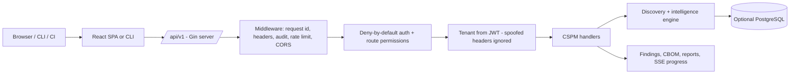

# OSS-to-Enterprise System Architecture and Security Review

Date: 2026-11-23  
Scope: `/Users/re1/re1/CSPM` — CSPM + standalone EaaS, including frontend, Go services, CLI, CI/CD, deployment manifests, docs, and configuration surfaces.  
Method: source/docs review, static security review, deployment/config review, and local tool-assisted checks. No runtime exploitation and no production infrastructure review.

## Verdict

The repository has a coherent **OSS-to-Enterprise architecture** with a shared engine, separate OSS/Enterprise binaries, signed license gating, deny-by-default API auth, and mostly honest “unconfigured/unavailable” Enterprise states. It is suitable for a **labelled controlled pilot** of static cryptographic inventory.

It is **not production-ready for Enterprise or hosted EaaS**. The review found 12 distinct high-severity issues across application and deployment security, including cross-tenant data access on several enterprise routes, EaaS entitlement and verification bypasses, production demo exposure, non-blocking security CI gates, secret-bearing Docker build contexts, unreproducible Helm deployments, and unresolved historical SSH key exposure. Product documentation already states the correct top-line maturity: `PARTIALLY IMPLEMENTED — controlled pilot ready for static cryptographic inventory; production Enterprise remains BLOCKED BY EXTERNAL CONFIGURATION`.

Companion detail: [CSPM + EaaS security review canvas](/Users/re1/.cursor/projects/Users-re1-re1-CSPM/canvases/cspm-eaas-security-review.canvas.tsx).

## 1. System architecture

### 1.1 Components

| Layer | Components | Evidence |
|-------|------------|----------|
| Entry points | `cmd/server/main.go`, OSS server, Enterprise build-tagged server, standalone EaaS server, RivicQ CLI, GitHub Action/webhook operators | `cmd/server/oss/main.go`, `cmd/server/enterprise/main.go`, `cmd/eaas/main.go`, `cmd/rivicq/main.go`, `docs/ARCHITECTURE.md` |
| Shared server | Env/config loading, edition detection, optional PostgreSQL, migrations, middleware, health/readiness, route mounting, graceful shutdown | `internal/server/server.go`, `internal/config`, `internal/database/database.go` |
| Frontend | React SPA, theme/providers, auth/edition guards, grouped console shell, dashboard/CBOM/findings/architecture pages, demo adapter | `web/src/App.tsx`, `web/src/theme`, `web/src/layouts/Layout.tsx`, `web/src/services/api.ts`, `web/src/demo` |
| Authn/RBAC | Registration, verification, login, MFA, JWT access tokens, rotating refresh sessions, password reset, deny-by-default gate, route permissions, roles | `internal/authn`, `internal/auth/public_routes.go`, `internal/auth/route_permissions.go`, `internal/auth/rbac.go` |
| Tenancy | Tenant identity derived from validated JWT/API credential; `X-Tenant-ID` ignored; tenant-partitioned scan jobs and results | `internal/tenant/context.go`, `internal/discovery/scan_manager.go`, `docs/ENTERPRISE.md` |
| Discovery engine | TLS/SSH/HTTP scanners, SBOM parsers, firmware/identity analyzers, target policy, safe dialer, scan manager, SSE progress | `internal/discovery`, `internal/intelligence`, `internal/firmware`, `internal/identity` |
| Intelligence/reporting | Findings, scoring, CBOM/CycloneDX export, QBOM Enterprise gate, policy gate actions, dashboard/report handlers | `internal/api/shared/handlers.go`, `internal/api/shared/qbom.go`, `docs/BOM_FRAMEWORK.md` |
| Enterprise control plane | Signed license enforcement, edition flags, cloud/Kubernetes/CNCF/Terraform/quantum/HSM/attestation/API-key/webhook/audit handlers | `internal/edition/edition.go`, `internal/api/enterprise`, `internal/quantum` |
| EaaS | Independent router, account/session lifecycle, hashed API keys, operation catalog, quotas/RPM, server-held keys, sandbox store, portal | `internal/eaas`, `web/eaas/index.html`, `deploy/migrations/004_eaas_schema.sql` |
| Commercial layer | Leads, status, plan catalogue, payment adapter stub, Zoho/Discord helpers, admin readiness report | `internal/platform`, `docs/PRODUCT_STATUS.md` |
| Delivery | GitHub Actions, Docker Compose, Dockerfiles, Helm charts, GitHub Pages, Cloudflare headers, Render config | `.github/workflows`, `deploy/docker`, `deploy/helm`, `docker-compose.yml`, `render.yaml`, `cloudflare/_headers` |

### 1.2 Request and data flows

- **CSPM scan flow:** `POST /api/v1/scans` or `POST /api/v1/cbom/:id/scan` → tenant-scoped scan job → target policy check → TLS/SSH/HTTP/SBOM scanners → persisted callback when DB is configured → tenant-scoped status/report reads. Evidence: `internal/api/shared/handlers.go`, `internal/discovery/scan_manager.go`, `internal/discovery/target_policy.go`, `internal/discovery/scanner.go`.
- **Auth flow:** public allow-list only for explicitly listed routes → token verification → current user reload → disabled-user rejection → identity written to Gin context → path-prefix authorization → tenant derivation. Evidence: `internal/auth/public_routes.go`, `internal/authn/enforce.go`, `internal/auth/route_permissions.go`, `internal/tenant/context.go`.
- **Enterprise flow:** edition detection → signed unexpired `cryptobom-beta-v1.*` license check at startup → Enterprise routes mounted → DB fail-closed → admin gates on cloud/SSO/API-key/webhook/audit mutations → unconfigured providers report `status: unavailable`. Evidence: `internal/server/server.go`, `internal/api/enterprise/license.go`, `internal/api/enterprise/demoguard.go`, `internal/api/enterprise/handlers.go`.
- **EaaS flow:** register/login → project/API key/server-held key → operation invoked by API key identity → monthly quota and RPM checks → crypto operation → metadata-only usage event. No payload, key, or secret is written by the operation path. Evidence: `internal/eaas/http.go`, `internal/eaas/service.go`, `internal/eaas/crypto.go`.
- **Static Pages flow:** browser-only demo adapter answers scan calls; no customer data leaves the browser and no backend is inferred. Evidence: `web/src/demo/scanDemo.ts`, `docs/KNOWN_LIMITATIONS.md`.

### 1.3 Trust boundaries

| Boundary | Current design | Evidence |
|----------|----------------|----------|
| External network | Exact-origin CORS, credentialed CORS refused for wildcard, proxy trust opt-in, security headers, request IDs, audit, rate limiting | `internal/middleware/cors.go`, `internal/middleware/middleware.go`, `internal/middleware/security.go`, `internal/middleware/audit.go` |
| Authentication | Deny-by-default `/api/v1`; explicit public allow-list; JWT issuer/audience/expiry; startup secret length enforcement | `internal/auth/public_routes.go`, `internal/authn/token.go`, `internal/authn/config.go` |
| Authorization | Role hierarchy viewer < analyst < operator < admin; unmapped mutations denied; resource-prefix map | `internal/auth/rbac.go`, `internal/auth/route_permissions.go` |
| Tenancy | JWT-derived tenant; spoofed `X-Tenant-ID` ignored; scan jobs/results keyed by tenant | `internal/tenant/context.go`, `internal/discovery/scan_manager.go` |
| Scanner | Private/local/link-local targets denied by default; policy propagated to sub-scanners to reduce DNS-rebinding risk | `internal/discovery/target_policy.go`, `internal/discovery/safe_dial.go`, `internal/discovery/scanner.go` |
| Enterprise/license | Enterprise binary fails closed without signed, unexpired, tenant-bound license | `cmd/server/enterprise/main.go`, `internal/api/enterprise/license.go` |
| EaaS | Session auth, hashed API keys, strict exact-origin CORS, no payload/key/secret persistence in operation path | `internal/eaas/http.go`, `internal/eaas/service.go` |
| Frontend entitlement | UI edition/role guards are UX only; server permissions remain authoritative | `web/src/config/editions.ts`, `web/src/components/RequireEnterprise.tsx`, `docs/ENGINEERING_AUDIT.md` |

### 1.4 OSS-to-Enterprise boundary

- One codebase, two server binaries, one shared engine: `docs/OPENSOURCE.md`, `docs/editions.md`.
- OSS build is enforced in CI: `go build -tags oss` and a check that the enterprise package is unreachable: `.github/workflows/ci-cd.yml`.
- Enterprise is build-tagged and fails closed without a valid signed license: `cmd/server/enterprise/main.go`.
- Enterprise DB and migrations are fail-closed: `internal/api/enterprise/handlers.go`.
- Enterprise-only capability examples: QBOM returns `403`, live Kubernetes/cloud connectors, quantum, HSM, SSO, audit, API keys/webhooks, and BOM layers: `internal/api/shared/qbom.go`, `internal/edition/edition.go`.
- Known documentation drift: several docs still describe obsolete `ENT-...` license activation. Current runtime accepts only signed `cryptobom-beta-v1.<tenant|*>.<expiry>.<hmac>` licenses. Relevant stale docs: `docs/ARCHITECTURE.md`, `docs/OPENSOURCE.md`, `docs/DECISIONS.md`, `docs/PRD.md`, `docs/TRD.md`, `docs/SRD.md`, `docs/CLIENT_ARCHITECTURE.md`.

### 1.5 Deployment topology

| Surface | Binding/deployment | Status |
|---------|--------------------|--------|
| OSS API | `:8080`, Docker Compose, OSS Helm chart | Implemented for local/self-host; production security depends on operator config |
| Enterprise API | `:9090`, Enterprise Helm chart, deploy stages | Implemented code paths; external config and deployment defects remain |
| React console | GitHub Pages static demo or self-hosted build | Demo verified; production backend requires `REACT_APP_API_URL` and CORS |
| EaaS | Separate `:9091` router and portal | Local sandbox only; hosted/production blocked |
| CLI/GitHub integration | `cmd/rivicq`, GitHub Action, webhook | Implemented; self-scan CI gate is currently non-blocking |

## 2. Security assessment

### 2.1 Verified controls

| Control | Evidence | Result |
|---------|----------|--------|
| Deny-by-default API auth | `internal/auth/public_routes.go`, `internal/api/shared/standard_auth.go`, `internal/auth/route_permissions.go` | Unlisted routes require auth; unmapped mutations fail closed |
| JWT secret enforcement | `internal/authn/config.go` | Startup fails below 32-byte secret |
| Current-user reload | `internal/authn/enforce.go` | Disabled users are rejected after token verification |
| Tenant header rejection | `internal/tenant/context.go` | `X-Tenant-ID` is ignored |
| SQL parameterization | `internal/database/queries.go`, SQL construction review | No obvious string-built SQL injection found |
| GitHub webhook signature | `internal/api/shared/github_scanning.go` | HMAC-SHA256, `hmac.Equal`, disabled without secret, bounded body, replay tracking |
| OAuth state handling | `internal/api/shared/oauth_redirect.go`, GitHub/Google OAuth handlers | Time-boxed, single-use state/exchange records |
| EaaS credential storage | `internal/eaas/store.go`, `internal/eaas/service.go` | Sessions and API keys stored by hash; secret shown once |
| Enterprise fail-closed defaults | `internal/api/enterprise/handlers.go`, `internal/api/enterprise/demoguard.go` | Missing DB is fatal; unconfigured capabilities report unavailable |
| Health/readiness separation | `internal/server/server.go` | `/readyz` fails in demo mode |
| CORS exact origins | `internal/middleware/cors.go` | Wildcard with credentials refused |
| golangci-lint | local command | `0 issues` |

### 2.2 High-severity findings

| ID | Finding | Evidence | Impact | Required fix |
|----|---------|----------|--------|--------------|
| H-01 | Cross-tenant enterprise record access/writes | `internal/api/enterprise/multicloud.go:212-221,242`; `cncf.go`; `terraform.go`; `quantum_attestation.go`; `internal/api/shared/handlers.go:440-463` | ID-based queries omit tenant/account predicates; authenticated users can read or mutate other tenants' rows | Add tenant predicates to every ID-based query, verify affected rows, add cross-tenant regression tests |
| H-02 | EaaS plan self-upgrade without payment | `internal/eaas/http.go:338-357`, `internal/eaas/service.go:835-855`, `internal/eaas/plans.go:51-57` | Any authenticated user can select enterprise and receive unlimited entitlements immediately | Gate plan changes behind billing/contract workflow or admin control; remove enterprise from self-service |
| H-03 | EaaS verification bypass | `cmd/eaas/main.go:17`, `internal/eaas/service.go:80,124-128,174-177` | Verification code is returned in API responses unless environment is exactly `production`; default is development and `prod` is not recognised | Never return verification material; require mailer; normalize env aliases; fail startup when ambiguous |
| H-04 | Production demo mode only warns | `internal/api/shared/standard_auth.go:28-36,56-62`, `internal/auth/public_routes.go:40`, `internal/authn/handlers.go:490-505` | Misconfigured production leaves a public demo login that issues real sessions | Make production + demo mode fatal; remove demo identity outside explicit non-production builds |
| H-05 | EaaS persistence/custody is sandbox-grade | `internal/eaas/store.go:12-32,195-204`, `internal/eaas/service.go:679-694`, `deploy/migrations/004_eaas_schema.sql:47-56` | Private key bytes are base64 in a JSON file; no Postgres repository or HSM/KMS custody | Block production startup until SQL persistence and KMS/HSM-backed key references exist |
| H-06 | Security CI gates are advertised as blocking but often are not | `.github/workflows/rivicq-security.yml:30-32`; `ci-cd.yml:63-75`; `snyk-security.yml:51-61`; `dast-scan.yml:16-18` | BLOCK findings, gosec, Snyk, lint, and DAST results can be ignored | Add pipefail, remove `continue-on-error`/`|| true`, enforce severity thresholds, decide SARIF destination |
| H-07 | Docker build context can include secrets | `.gitignore:55-56`, `deploy/docker/Dockerfile.*`, `scripts/build-pages.sh`, `scripts/deploy-gh-pages.sh` | Local `.env`, kubeconfigs, keys, and caches can enter builder layers or remote caches | Commit root `.dockerignore`, use explicit COPY, rotate exposed credentials, audit Actions caches |
| H-08 | Known development credentials can reach production | `.env.example`, `docker-compose.yml`, `run-edition.sh:22-25`, `internal/api/shared/standard_auth.go:38-45` | Denylist misses documented bootstrap password; production detection is inconsistent; scripts export dev secrets | Replace denylist with per-deployment generated allowlist; unify production detection; refuse local-only defaults |
| H-09 | Helm deployments are not reproducible/renderable | `Chart.yaml` floating deps, missing tracked tarballs, OSS secret gap, SaaS value/template drift, `deploy-stages.yml` | Clean clone cannot reliably lint/deploy; stage/prod can fail or produce broken configuration | Commit lock/charts, run `helm dependency build` in CI, fix templates, add `helm template` checks |
| H-10 | Deploy workflows can apply placeholder secrets and bypass TLS | `deploy-enterprise.yml:81-88`, `deploy/kubernetes/secret-template.yaml`, `deploy/kubernetes/service.yaml`, `rollback.yml` | Placeholder secrets can overwrite real ones; HTTP LoadBalancer bypasses ingress; rollback can target wrong cluster | Never apply secret templates by directory glob; remove LoadBalancer; persist `KUBECONFIG`; restrict file permissions |
| H-11 | SaaS Helm defaults are over-privileged | `deploy/helm/cryptobom-saas/values.yaml:16-41,115-120`, `templates/deployment.yaml:31-36,98-111` | Privileged, host-PID, host-network workload with host `/proc` and `/sys`; NetworkPolicy selector mismatch | Disable by default, fix selectors, drop host mounts, add policy tests |
| H-12 | Historical SSH keys remain recoverable | `docs/SECURITY_SECRET_REMEDIATION.md:8-20,42-44` | Two encrypted OpenSSH keys were committed then deleted; history purge pending and rotation not fully evidenced | Confirm rotation, remove old trust, complete coordinated history rewrite or accept with owner sign-off |

### 2.3 Medium and low findings (summary)

| Severity | Findings |
|----------|----------|
| Medium | Bearer token accepted in query string; enterprise webhook SSRF via unvalidated URL; SSH banner raw-dial bypass; public payment webhook stub unsigned/unbounded; MFA challenge not consumed on failure; fragmented process-local throttling; permissive CSP plus localStorage tokens; API-key middleware unwired and scopes unvalidated; EaaS lacks request audit logging |
| Medium | Actions/tool pinning and SBOM/provenance incomplete; broad deploy permissions and token-in-URL script; action inputs interpolated into shell; `REACT_APP_*` build-time values are public; EaaS lacks CSP/HSTS and production deployment gate; container hardening inconsistent; “strict production validation” uses dummy credentials; local scan-target expansion flags enabled in local env |
| Low | Raw emails in auth logs; expired EaaS state never purged; static EaaS admin token without rate limit/audit; EaaS portal lacks CSP; Node/toolchain doc drift; health endpoint discloses operational detail; inert OSS Helm CORS value; Render free-tier and fixed bootstrap identity |

### 2.4 Tool-assisted checks

| Check | Result | Interpretation |
|-------|--------|----------------|
| `npm run type-check && npm run lint && CI=true npm test -- --watchAll=false --coverage=false && npm run build` | Passed — 36 suites / 126 tests; production build for `/RivicQ_CSPM_EaaS/` | Frontend correctness verified; does not imply dependency security |
| `go build ./... && go test ./... && go vet ./... && test -z "$(gofmt -l .)" && git diff --check` | Passed | Go correctness verified |
| `golangci-lint run --timeout 5m ./...` | `0 issues` | Static lint clean |
| `npm audit --omit=dev --audit-level=high` | 58 vulnerabilities: 9 low, 14 moderate, 32 high, 3 critical | Includes runtime and build/test tree; high/critical include `axios`, `body-parser`, `brace-expansion`, `fast-uri`, `follow-redirects`, `form-data`, `js-yaml`, `nanoid`, `node-forge`, `postcss`, `proxy-addr`, `shell-quote`, `websocket-driver`, `ws`; requires dependency upgrade plan |
| `govulncheck ./...` | 2 reachable Go vulnerabilities: `GO-2026-6975` and `GO-2026-6974` in `go.opentelemetry.io/otel` v1.45.0, fixed in v1.47.0 | Upgrade OTel modules |
| `gosec -quiet ./...` | 80 issues | Many are fixtures/synthetic or intentional scanner behavior, but includes real review items: variable URL/path findings in CLI/operators, TLS skip-verify in scanner, hardcoded example credentials, and EaaS store file access; CI currently makes gosec non-blocking |
| `gitleaks detect --no-git --redact --no-banner --exit-code 0` | 759 redacted matches across 263.36 MB in 2m57s | Local filesystem scan includes untracked `.env`, fixtures, and generated content; values redacted and not triaged here. Tracked-tree advisory documents two historical encrypted SSH keys and synthetic fixtures |
| `helm lint deploy/helm/cryptobom-oss deploy/helm/cryptobom-enterprise deploy/helm/cryptobom-saas` | 3 charts linted, 0 failed; Enterprise warns for missing required secret values | Lint passes, but deployment agent found render/config defects and reproducibility gaps not caught by lint |

Note: `gosec` flagged `internal/eaas/crypto.go:138` as a hardcoded nonce; source review shows the nonce is generated with `crypto/rand` at `internal/eaas/crypto.go:131-134`, so that specific finding is a false positive.

## 3. Product honesty and maturity

| Area | Status | Basis |
|------|--------|-------|
| Static cryptographic inventory / CBOM | Production implemented in code; pilot-ready | `docs/IMPLEMENTATION_STATUS.md`, `docs/PRODUCT_STATUS.md` |
| OSS-to-Enterprise binary/license split | Implemented | `cmd/server/enterprise/main.go`, `internal/edition/edition.go`, CI OSS gate |
| Enterprise cloud/SSO/quantum/HSM connectors | Integration pending; unconfigured states honest | `docs/KNOWN_LIMITATIONS.md`, `internal/api/enterprise/demoguard.go` |
| RLS and hosted DB | Planned / blocked by external configuration | `docs/PRODUCT_IMPROVEMENT_PLAN.md`, `docs/IMPLEMENTATION_STATUS.md` |
| EaaS local sandbox | Verified / limited | `docs/EAAS_DEPLOYMENT.md`, `internal/eaas` |
| EaaS hosted production | Not implemented / blocked | Postgres repository, KMS/HSM, email, payments, deployment gate absent |
| Compliance scores | Taxonomies and mappings, not certifications | `docs/PRODUCT_STATUS.md`, `web/src/components/TrademarkNotice.tsx` |
| Browser screenshots/responsive review | Pending | No local browser automation available |

## 4. Remediation roadmap

### P0 — before any Enterprise pilot beyond a controlled lab

1. Add tenant predicates and cross-tenant tests to every ID-based enterprise query (`H-01`).
2. Disable EaaS self-service enterprise upgrades and verification-code disclosure (`H-02`, `H-03`).
3. Make production + demo mode fatal and unify production detection (`H-04`, `H-08`).
4. Block EaaS production startup without SQL persistence and KMS/HSM key references (`H-05`).
5. Make security CI gates actually fail on configured severity thresholds (`H-06`).

### P1 — before public hosting or real customer data

6. Commit root `.dockerignore`, remove local secrets from build contexts, rotate exposed credentials, audit Actions caches (`H-07`).
7. Make Helm reproducible and renderable; fix OSS secret handling, SaaS value/template drift, and deploy-stage secret values (`H-09`, `H-10`).
8. Remove over-privileged SaaS defaults and fix NetworkPolicy selectors (`H-11`).
9. Confirm rotation/history remediation for the committed SSH keys (`H-12`).
10. Constrain webhook destinations and remove the SSH banner raw-dial bypass.
11. Upgrade OTel modules and produce a dependency upgrade plan for the 58 npm findings.

### P2 — hardening and evidence quality

12. Remove query-string bearer tokens; move frontend tokens out of localStorage; tighten CSP.
13. Add distributed rate limiting, EaaS audit logging, and EaaS CSP/HSTS.
14. Wire and validate API-key middleware scopes before enabling it.
15. Replace dummy-credential “production validation” with environment-scoped checks using real OIDC credentials.
16. Add SBOM/provenance to active release workflow or remove provenance claims.
17. Complete browser screenshots at 1920×1080, 1600×900, 1440×900, 1366×768, tablet, and mobile.

## 5. Review limitations

- No runtime exploitation was performed.
- No production database, cloud account, HSM/QKD/QRNG hardware, IdP, PSP, mailer, or cluster was available for review.
- Dependency audit results are advisory until fixed versions are tested for compatibility.
- Gitleaks output was redacted; 759 matches were not individually triaged in this review.
- Static security review cannot prove absence of vulnerabilities.
- Product/commercial bottleneck remains customer validation; security remediation does not replace the five security-leader interviews documented in `recommended-next-step.md`.

## 6. Evidence index

- Architecture: `docs/ARCHITECTURE.md`, `docs/OPENSOURCE.md`, `docs/ENTERPRISE.md`, `docs/editions.md`, `docs/EAAS_DEPLOYMENT.md`, `docs/KNOWN_LIMITATIONS.md`
- Runtime: `cmd/server`, `internal/server`, `internal/edition`, `internal/database`, `internal/api`, `internal/discovery`, `internal/eaas`
- Security: `internal/authn`, `internal/auth`, `internal/tenant`, `internal/middleware`, `docs/SECURITY_SECRET_REMEDIATION.md`, `docs/DEVSECOPS.md`
- Deployment: `.github/workflows`, `.github/actions`, `deploy/docker`, `deploy/helm`, `deploy/kubernetes`, `docker-compose.yml`, `render.yaml`, `cloudflare/_headers`
- Frontend: `web/src`, `web/eaas/index.html`, `web/package.json`
- Existing maturity docs: `docs/PRODUCT_STATUS.md`, `docs/IMPLEMENTATION_STATUS.md`, `docs/UX_REDESIGN_REPORT.md`
